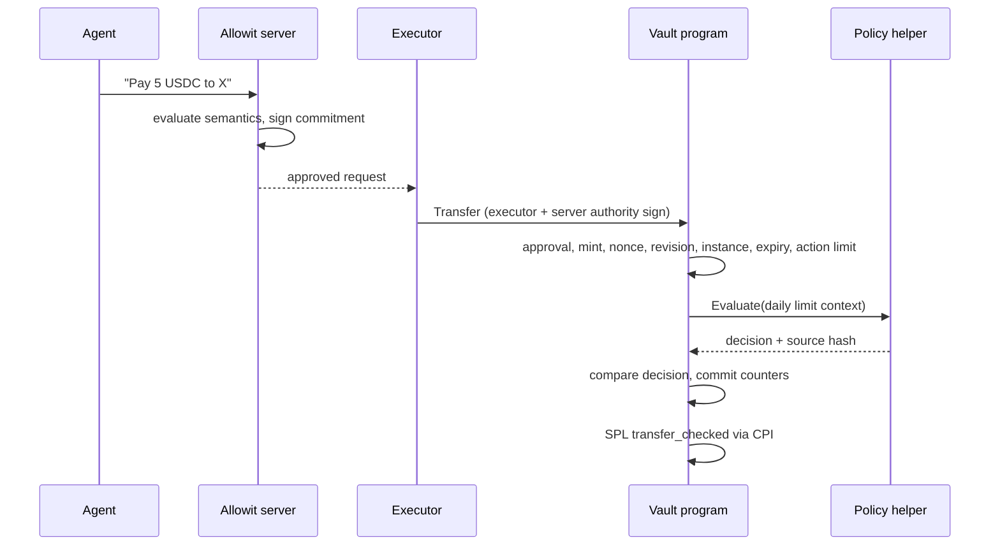

<!-- prettier-ignore -->
<div align="center">

# Allowit contracts for Solana

*Custody that says no for you. On-chain spending limits for AI agents.*

[](https://github.com/allowit-hq/allowit-contracts-solana/actions/workflows/contracts.yml)
[](rust-toolchain.toml)
[](https://github.com/anza-xyz/agave/releases/tag/v4.3.0)
[](#quick-start)

[What is this?](#what-is-this) • [How a payment happens](#how-a-payment-happens) • [Quick start](#quick-start) • [Using the vault](#using-the-vault) • [Deploy to Devnet](#deploy-to-devnet) • [Part of Allowit](#part-of-allowit)

</div>

**Go on. On your terms.** Allowit lets your AI agents spend and invest, within a policy you set. This repository is the Solana half of that promise: the on-chain programs that hold the money and refuse anything past the owner's limits, even when every off-chain service has been compromised.

## What is this?

Three native Rust programs and one shared policy source. The host crates that talk to them live in the [Allowit SDK](https://github.com/allowit-hq/allowit-sdk/tree/main/rails/solana).

| Piece | What it does | Where |
| --- | --- | --- |
| **Vault** | Holds SPL tokens in a per-vault PDA. Checks approval, limits, nonce, revision, instance and expiry before every transfer. | [`programs/vault`](programs/vault/src/lib.rs) |
| **Policy helper** | A tiny immutable program the vault calls to check approval and the daily limit. No accounts, no custody, no surprises. | [`programs/policy`](programs/policy/src/lib.rs) |
| **PaySH** | A separate, upgradeable profile for paying services in USDC or swapping SOL to USDC, each request signed by an evaluator and bounded by owner budgets. | [`programs/paysh`](programs/paysh/src/lib.rs), [docs](docs/paysh.md) |
| **Portable policy** | The `require_approval` + `enforce_daily_limit` rule, shared byte-for-byte with the [Stellar contracts](https://github.com/allowit-hq/allowit-contracts-stellar) and hashed into both builds. | [`policy/`](policy/policy.rs) |
| **ABI crates** | Borsh layouts for the vault ([ABI 2](crates/interface/src/lib.rs)) and the PaySH request protocol ([v2](crates/paysh-interface/src/lib.rs)). | [`crates/interface`](crates/interface), [`crates/paysh-interface`](crates/paysh-interface) |

### Why a custody program?

An agent with a wallet key can spend everything in it. An agent that asks a server for permission is safe only while that server is honest. Allowit puts the hard limits in a place neither of them controls:

- **The owner configures and recovers.** Fund, approve, tune, withdraw, close. No evaluator signature needed to get your money back.
- **Two signatures move money.** An automated transfer needs the executor *and* the server authority on the exact transaction. Neither alone is enough.
- **The chain keeps the counters.** Daily spend, per-action ceiling, replay nonce and config revision live in the vault state, not in anyone's database.
- **The policy is pinned.** The vault stores the hash of the policy source and the deployed helper artifact, and checks both before it listens to a decision.

## How a payment happens



1. The owner creates a vault with a USDC-style mint, an executor key, a server authority key and limits, then deposits and approves. Setup can be one owner-signed transaction.
2. An agent asks the Allowit server to spend. The server runs its semantic checks and commits to the exact request.
3. The executor submits `Transfer`. The vault requires the executor and the server authority as signers, and rejects any request whose nonce, revision, instance slot or expiry is stale. Expiry can be at most 300 seconds ahead of chain time.
4. The vault asks the pinned policy helper whether the amount fits today's budget, checks the returned source hash and binding, and independently recomputes the expected cumulative spend.
5. Counters and the token movement commit atomically. If any step fails, nothing moves.

Only the owner can withdraw, close, revoke approval or change the action limit, and none of those paths call the policy helper or need an evaluator. [Wallet signing and contract custody](docs/architecture.md) goes deeper on the boundaries.

## Quick start

You need **Rust 1.98.0** (pinned by [`rust-toolchain.toml`](rust-toolchain.toml)), **Agave 4.3.0** for `cargo build-sbf` and the `solana` CLI, and **platform-tools v1.57**. Python 3 runs the helper scripts.

```sh
git clone https://github.com/allowit-hq/allowit-contracts-solana.git
cd allowit-contracts-solana

# 1. Confirm the portable policy bundle hash is current (prints the bundle hash)
python3 scripts/check-policy.py

# 2. Host-side unit tests for the policy, interfaces and vendor crate
cargo test --workspace --locked

# 3. Compile the three programs for sBPF v3
cargo build-sbf --manifest-path programs/policy/Cargo.toml --arch v3 --optimize-size --tools-version v1.57 -- --locked
cargo build-sbf --manifest-path programs/vault/Cargo.toml --arch v3 --optimize-size --tools-version v1.57 -- --locked
cargo build-sbf --manifest-path programs/paysh/Cargo.toml --arch v3 --optimize-size --tools-version v1.57 -- --locked

# 4. Run the compiled vault and PaySH programs against real SPL Token transfers (Mollusk)
SBF_OUT_DIR="$PWD/target/deploy" cargo test --manifest-path sbf-tests/Cargo.toml --locked --test vault --test paysh
```

The PaySH swap tests also need a Whirlpool program. `bash scripts/build-whirlpool-test.sh` downloads a pinned Orca source archive, checks its SHA-256 and builds it into `target/whirlpool-fixture/`. Then add `--test paysh_whirlpool` to step 4, or drop the `--test` flags to run every suite. If you move the fixture with `WHIRLPOOL_FIXTURE_DIR`, point the tests at the built program with `WHIRLPOOL_SBF_PATH=<dir>/target/deploy/whirlpool.so`.

> [!TIP]
> Every crate and program is a member of the root Cargo workspace. Test one with `cargo test --locked -p <package>`.

## Using the vault

### Units and limits

- Amounts are in six-decimal token units: `1_000_000` = one token. The vault only accepts mints with six decimals.
- `daily_limit` and `action_limit` are capped at `50_000_000` (fifty tokens). Days are UTC days.
- A limit of zero pauses spending. Funding never resets the spent counter.
- `SetPolicy` clears approval; the owner must `Approve(true)` again. `SetDailyLimit` keeps approval.
- Every owner change bumps `revision` and every transfer bumps `nonce`. A request built against old values fails with `StaleRequest`.

### Instructions

Account order for [ABI 2](crates/interface/src/lib.rs). `w` writable, `s` signer. Vault PDA seeds are `[b"allowit-vault-v2", owner, vault_id]`; state is 352 bytes.

| Instruction | Accounts |
| --- | --- |
| `Initialize` | vault(w), owner(w,s), mint, vault token, policy, executor, System Program, policy ProgramData, authority |
| `Deposit` | vault(w), owner(s), owner source token(w), vault token(w), mint, SPL Token Program |
| `Approve` | vault(w), owner(s), policy, policy ProgramData (only when approving) |
| `SetDailyLimit` / `SetPolicy` | vault(w), owner(s), policy, policy ProgramData |
| `Transfer` | vault(w), executor(s), vault token(w), recipient token(w), mint, SPL Token Program, policy, policy ProgramData, authority(s) |
| `Withdraw` | vault(w), owner(s), vault token(w), owner destination token(w), mint, SPL Token Program |
| `SetActionLimit` | vault(w), owner(s) |
| `Close` | vault(w), owner(w,s), vault token(w), owner destination token(w), mint, SPL Token Program |
| `Unsupported` | none |

Owner, executor and authority must be three different keys. The vault rejects transfers to any token account it owns itself and checks that the recipient holds the vault's mint. Custom errors start at `100` for the vault (`UnsupportedMethod` … `Expired`) and at `1000 + n` for policy errors; see the enums in [`programs/vault/src/lib.rs`](programs/vault/src/lib.rs) and [`policy/policy_api.rs`](policy/policy_api.rs).

### Policy identity

The portable policy is two files, [`policy.rs`](policy/policy.rs) and [`policy_api.rs`](policy/policy_api.rs). Their literal bytes are hashed into `SOURCE_HASH`, which the helper returns with every decision and the vault compares against its pinned `policy_source`. The compiled helper's bytes are a second identity, `policy_artifact`, checked against the immutable ProgramData before every invocation.

```sh
python3 scripts/check-policy.py                         # verify, print the bundle hash
python3 scripts/check-policy.py --write                 # regenerate policy/source_hash.rs after an intended edit
python3 scripts/check-policy.py --peer ../allowit-contracts-stellar   # confirm Stellar carries identical bytes
```

Pin both hashes together with the chain, ABI, program IDs and authorities when you configure a client.

### Recovering an uncertain transaction

Save the signed transaction bytes before you broadcast. If the result is unknown, look the original up before you sign a replacement; the vault's nonce makes a duplicate fail, but only if you resend the same request. The SDK's [vendor crate](https://github.com/allowit-hq/allowit-sdk/tree/main/rails/solana/solana-vendor) does this reconciliation for PaySH operations.

## Deploy to Devnet

Build the exact revision the consuming SDK pins; the tip of `main` is not necessarily a release. Use fresh keys outside the checkout and check the cluster supports sBPF v3. The native-vault SDK profile verifies the source bundle, the deployed artifact bytes and the *absence* of an upgrade authority for both programs. `--final` is permanent, so compare hashes before you pass it.

```sh
cluster=devnet
key_dir="$HOME/.local/share/allowit-solana-devnet"
mkdir -p "$key_dir"
chmod 700 "$key_dir"
solana-keygen new --no-bip39-passphrase --silent --outfile "$key_dir/deployer.json"
solana-keygen new --no-bip39-passphrase --silent --outfile "$key_dir/policy.json"
solana-keygen new --no-bip39-passphrase --silent --outfile "$key_dir/vault.json"
solana --url "$cluster" genesis-hash
solana --url "$cluster" --keypair "$key_dir/deployer.json" airdrop 5
solana --url "$cluster" --keypair "$key_dir/deployer.json" balance

policy_size=$(wc -c < target/deploy/allowit_policy.so | tr -d ' ')
vault_size=$(wc -c < target/deploy/allowit_vault.so | tr -d ' ')
solana --url "$cluster" --keypair "$key_dir/deployer.json" program deploy \
  target/deploy/allowit_policy.so --program-id "$key_dir/policy.json" \
  --max-len "$policy_size" --final
solana --url "$cluster" --keypair "$key_dir/deployer.json" program deploy \
  target/deploy/allowit_vault.so --program-id "$key_dir/vault.json" \
  --max-len "$vault_size" --final

policy_id=$(solana-keygen pubkey "$key_dir/policy.json")
vault_id=$(solana-keygen pubkey "$key_dir/vault.json")
dump_dir=$(mktemp -d)
solana --url "$cluster" program show "$policy_id"
solana --url "$cluster" program show "$vault_id"
solana --url "$cluster" program dump "$policy_id" "$dump_dir/policy.so"
solana --url "$cluster" program dump "$vault_id" "$dump_dir/vault.so"
cmp target/deploy/allowit_policy.so "$dump_dir/policy.so"
cmp target/deploy/allowit_vault.so "$dump_dir/vault.so"
```

A few things worth knowing:

- `cluster=testnet` follows the same steps with its own key directory. Clusters do not share vaults, balances or approvals.
- `--max-len` set to the exact size keeps trailing capacity bytes from changing the deployed hash.
- Record program and ProgramData IDs, the genesis hash, artifact hashes and the absent upgrade authorities. Configure the SDK or backend with that cluster's mint, executor and server authority before you initialize vaults.
- PaySH is not part of this flow. It needs its own deployment, token accounts, treasury and Whirlpool pool; see [its deployment notes](docs/paysh.md#deployment).

The [`Solana runtime smoke`](.github/workflows/integration-runtime.yml) workflow shows the same procedure done by CI with persistent program and buffer identities, byte-exact verification and immutability finalization.

## Project structure

```text
.
├── policy/                 Portable policy source, API, tests and SOURCE_HASH
├── programs/
│   ├── policy/             Immutable helper (pinocchio, no_std, no accounts)
│   ├── vault/              Custody program: PDA state + SPL Token CPI
│   ├── paysh/              Upgradeable PaySH execution profile
│   └── mandate/            Mandate allowance program (allowit-solana) and its Mollusk tests
├── crates/
│   ├── interface/          Vault ABI 2 (Borsh)
│   └── paysh-interface/    PaySH v2 request protocol and service allowlist
├── native/                 @allowit/native: JavaScript native vault lifecycle
├── sbf-tests/              Mollusk tests against the compiled programs
├── scripts/                build.sh, check-policy.py, policy-smoke.rs, Whirlpool fixture
└── docs/                   Architecture, PaySH profile, native vault v2
```

- [`programs/mandate/`](programs/mandate/README.md) is the owner-approved mandate allowance program. It evaluates compiled policy IR with SDK core and spends through SPL Token `transfer_checked`. Its Mollusk harness `programs/mandate/sbf-tests/` keeps its own Cargo lockfile.
- [`native/`](native/README.md) is the JavaScript native SDK for the vault v2 lifecycle. Its Rust counterpart `allowit-native` is in the SDK's [`rails/solana/native/`](https://github.com/allowit-hq/allowit-sdk/tree/main/rails/solana/native).
- [`docs/native-vault-v2.md`](docs/native-vault-v2.md) describes the native vault v2 protocol.

## Part of Allowit

- [allowit.xyz](https://allowit.xyz): what Allowit is and how owners use it.
- [allowit-sdk](https://github.com/allowit-hq/allowit-sdk): the policy language, runtime, compiler and CLI that drive these programs, and the Solana host crates under `rails/solana/`. This repository depends on the SDK; the SDK does not depend on this repository.
- [allowit-contracts-stellar](https://github.com/allowit-hq/allowit-contracts-stellar): the same policy and owner-control principle on Soroban. `check-policy.py --peer` keeps the two in lockstep.
- The Allowit engine is the off-chain evaluator that signs requests. The SDK's Solana service packages were extracted from it.

## Contributing

Pull requests run the portable policy checks and `scripts/build.sh` ([`contracts.yml`](.github/workflows/contracts.yml)) and, when touched, the Node native SDK ([`native.yml`](.github/workflows/native.yml)) and the mandate program ([`mandate.yml`](.github/workflows/mandate.yml)). The compiled-program suites run nightly and on demand. Before you open a PR:

```sh
scripts/build.sh                             # fail on a stale allowit-sdk pin, then build the workspace and the SBF programs
python3 scripts/check-policy.py
cargo fmt --all --check
cargo fmt --manifest-path sbf-tests/Cargo.toml --check
cargo test --workspace --locked
```

`allowit-sdk` is the only git dependency. `[workspace.metadata.allowit.track]` in the root `Cargo.toml` says which commit it must be pinned to: `"head"` (the default branch tip), `{ branch = "name" }` or `{ version = "1.2.3" }` (tag `v1.2.3`). `scripts/build.sh --update` moves a stale pin and refreshes the locks. The script needs `git`, `cargo` and `jq`.

If you edit `policy/policy.rs` or `policy/policy_api.rs`, regenerate `source_hash.rs` with `--write` and make the identical change in the Stellar repository. [`AGENTS.md`](AGENTS.md) describes what belongs in this repository and what does not.

## License

Licensing is per package. `allowit-paysh-interface`, `@allowit/native` and the mandate program `allowit-solana` are MIT (see [`LICENSE`](LICENSE)). The other programs and the vault interface are `UNLICENSED`. Each `Cargo.toml` states its own terms.
