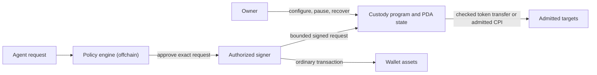

# Wallet signing and contract custody

Allowit keeps three jobs apart: deciding whether a request fits the policy, signing the transaction, and holding the money. This page explains why, and what each Solana program here does and does not guarantee. The [Stellar contracts](https://github.com/allowit-hq/allowit-contracts-stellar/blob/main/docs/architecture.md) apply the same owner-control principle on Soroban.

## Two ways to hold assets

**An ordinary wallet** holds assets under one signing key. Put a policy-checking signer in front of it and you get contract-free execution: the signer looks at the exact transaction, checks the policy, and signs or refuses. That is only as strong as the signer. The owner's signature alone does not create a limit the chain enforces.

**A program-controlled wallet** holds assets in program-derived accounts (PDAs). The custody program re-checks every delegated action itself before it signs a token transfer through cross-program invocation (CPI). An evaluator's approval becomes a veto on top of that, never a key to the vault. Threshold signing can protect either route, but a quorum does not replace the custody checks.

Both routes share the policy's meaning and bind to the exact action. They do not share custody authority. A server co-signature, an evaluator's request signature and a threshold signature are three different mechanisms and are never interchangeable.

## The Solana native vault

The [vault program](../programs/vault/src/lib.rs) speaks [ABI 2](../crates/interface/src/lib.rs). Three keys matter, and they must be distinct:

- **Owner**: creates, funds, approves, tunes, withdraws and closes the vault.
- **Executor**: submits automated transfers.
- **Server authority**: co-signs each automated transfer after the off-chain evaluation.

A `Transfer` needs the executor and the server authority as signers on the same transaction. The vault then checks approval, mint, the per-action and daily limits, nonce, revision, instance identity and expiry. It checks that the recipient holds the vault's mint and refuses to pay any token account the vault owns. Because the transaction signature covers the recipient, the recipient is bound exactly. Any further recipient rule lives off-chain unless custody code enforces it. The server's commitment attests that the off-chain assessment happened; it does not prove the assessment was semantically right.

For the daily limit, the vault invokes its pinned, immutable [policy helper](../programs/policy/src/lib.rs) with no custody accounts at all. The helper evaluates the [daily-limit template](../policy/policy.rs) and returns a decision, a binding and the source hash. The vault checks the binding and source, recomputes the expected cumulative spend on its own, and only then commits counters and token movement in one atomic step. The helper never runs owner-authored code and never calls the off-chain engine.

Owner paths stay independent of the evaluator:

- `Withdraw`, `Close`, `Approve(false)` and `SetActionLimit` need no evaluator signature and do not invoke the helper. `Approve(false)` still names the configured policy account.
- `SetDailyLimit` and `Approve(true)` invoke the pinned helper to validate the limit.
- `SetPolicy` verifies and invokes the newly supplied immutable helper before pinning it, and clears approval.
- Funding and policy changes preserve what has already been spent today.

The vault moves classic SPL tokens through `transfer_checked`. It has no general "call any program" interface.

## The PaySH profile

[PaySH](paysh.md) is a separate program for paying services. It verifies an evaluator's Ed25519 signature over a domain-separated request, then independently enforces owner configuration, service admission, replay receipts, budgets and the exact payment or admitted swap. Anyone can relay an accepted request unless the owner set `owner_only`. Owner pause and recovery bypass evaluator approval. PaySH and the native vault keep different ABIs, signing rules, counters and recovery paths.

## Owner control and program upgrades

A vault owner controls only what the custody program admits. The owner does not control the loader upgrade authority of a shared program, and an upgrade authority can replace the custody checks for every PDA that program controls. An immutable policy helper cannot protect against a compromised custody-program upgrade authority.

Owner-contained custody therefore means one of:

- an **immutable release** of the custody program, shared across independent PDAs. Fixes then require an owner-authorized migration to a new release; or
- a **separate deployment** under the owner's own upgrade governance, where upgrades are the owner's decision.

A mutable, system-managed custody program requires explicit trust in whoever holds its upgrade authority.

Engine administration must control only the engine: never custody upgrades, owner recovery, installed limits or agent delegation. Stellar's owner-selected wallet Wasm and Solana's loader authority need different deployment arrangements to preserve this boundary.

## Rules for new contract operations

Anything added to these programs keeps the following invariants:

- One complete policy source per admitted profile. Record which checks run locally and which depend on engine approval. Preserve branch and decision semantics.
- Authorization binds network, program, instance, owner configuration, policy revision, operation identity, exact accounts, target, arguments, assets, amounts, fees and expiry.
- Owner administration and recovery work without the engine. Spent capacity and replay history survive funding, configuration changes and engine replacement.
- Owner-approved local envelopes and persistent counters are enforced independently of the evaluator. Approval is authenticated for the exact request; missing, malformed or stale approval is rejected.
- General CPI stays disabled unless an adapter restricts targets, accounts, arguments and effects. A custody PDA signer is never forwarded to an unrestricted target.
- Baseline admission rejects token approvals, persistent allowances and uncontrolled token pulls. Gross debits and required credits are counted separately; incoming funds never hide outgoing spend.
- Effects, accounting and replay consumption commit atomically. One logical operation keeps one identity across replacement requests, and uncertain submissions are reconciled before another debit is authorized.

The threat model in one sentence: a compromised engine can approve anything inside its local delegation and spend that capacity, and it can lie about engine-only predicates, so every guarantee that must survive engine compromise belongs in owner-trusted custody code. Engine updates cannot fix custody bugs or widen owner-approved authority.
