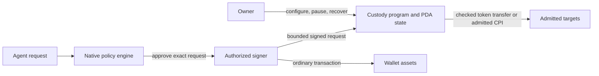

# Wallet signing and contract custody

AllowIt separates policy evaluation, signing and custody. The [execution profiles](https://github.com/AllowIt-hq/allowit.xyz-project/blob/main/wiki/allowit/execution-assurance.md) define their assurance boundaries. [Stellar custody architecture](https://github.com/AllowIt-hq/allowit-contracts-stellar/blob/main/docs/architecture.md) applies the same owner-control principle introduced in [Stellar PR 6](https://github.com/AllowIt-hq/allowit-contracts-stellar/pull/6).

## Signing and custody routes

An ordinary wallet holds assets under its signing authority. An isolated signer checks policy before signing the exact transaction. Contract-free execution depends on that signer for policy enforcement. Owner signing alone does not establish autonomous onchain limits.

A program-controlled wallet holds assets in program-derived accounts (PDAs). Its custody program independently checks delegated actions before signing token transfers through cross-program invocation (CPI). Evaluator approval adds a veto. It grants no owner administration or unrestricted custody signing authority. Threshold signing can protect either route, but quorum approval does not replace custody checks.

These routes share policy meaning and exact action bindings. They do not share custody authority. A server co-signature, an evaluator request signature and a threshold signature are separate authorization mechanisms.

## Solana interfaces

The [native vault](../programs/vault/src/lib.rs) uses [ABI 2](../crates/interface/src/lib.rs). Owner, executor and server authority are distinct. Automated transfers require executor and server signatures on the exact transaction. The vault checks approval, mint, recipient token account, action/day limits, nonce, revision, instance identity and expiry. The server commitment attests offchain assessment. It does not prove semantic correctness.

The vault invokes its pinned immutable [policy helper](../programs/policy/src/lib.rs) with no custody accounts. This helper checks the [daily-limit template](../policy/policy.rs). It does not execute arbitrary owner-authored policy or call the offchain engine. The vault checks the returned request/source binding and independently checks the expected cumulative spend before committing state and token movement atomically.

Owner withdrawal, close, `Approve(false)` and `SetActionLimit` require no evaluator signature or policy-helper invocation. `Approve(false)` still requires the configured policy account. `SetDailyLimit`, `SetPolicy` and `Approve(true)` invoke the pinned helper. Funding and policy changes preserve consumed spending. The native vault exposes direct classic SPL Token transfers, with no general target invocation interface.

The separate [PaySH profile](paysh.md) verifies an evaluator's Ed25519 signature over its domain-separated request. It independently enforces owner configuration, service admission, replay receipts, budgets and exact payment or admitted swap effects. Public submission can relay an accepted request unless owner-only execution applies. Owner pause and recovery bypass evaluator approval. PaySH and the native vault retain different ABIs, signing rules, counters and recovery paths.

## Owner control and program upgrades

A per-vault owner controls only the operations admitted by its custody program. That owner does not control the loader upgrade authority of a shared program. An upgrade authority can replace custody checks for every PDA controlled by that program. An immutable policy helper cannot contain a compromised custody-program upgrade authority.

For owner-contained custody, use an immutable custody release or a distinct custody deployment under the owner's selected upgrade governance. An immutable shared release amortizes code across independent PDA state. Kernel fixes then require an owner-authorized migration to a new release. A separate owner-controlled deployment permits upgrades under that owner's governance. A mutable system-managed custody program requires explicit trust in its upgrade authority.

Engine administration must control only the engine. It must not control custody upgrades, owner recovery, installed limits or agent delegation. Stellar's owner-selected wallet Wasm and Solana's loader authority require different deployment arrangements to preserve this boundary.

## Contract admission rules

Additional contract operations must preserve these rules:

- Compile one complete policy source for each admitted native or contract profile. Record which checks run locally and which depend on engine approval. Preserve branch and decision semantics.
- Bind authorization to network, program, instance, owner configuration, policy/module revision, operation identity, exact accounts, target, arguments, assets, amounts, fees and expiry.
- Keep owner administration and recovery independent of engine availability. Preserve spent capacity and replay history across funding, configuration changes and engine replacement.
- Enforce owner-approved local envelopes and persistent counters independently of the evaluator. Authenticate approval for the exact request. Reject missing, malformed or stale approval.
- Keep general CPI disabled unless an adapter restricts targets, accounts, arguments and effects. Do not forward a custody PDA signer to an unrestricted target.
- Reject token approvals, persistent allowances and uncontrolled token pulls in baseline admission. Count gross debits and required credits separately. Incoming funds must not conceal outgoing spending.
- Commit effects, accounting and replay consumption atomically. Preserve one logical operation identity across replacement requests and reconcile uncertain submissions before authorizing another debit.

A compromised engine can approve every action inside its local delegation and consume that capacity. It can falsify engine-only predicates. Every guarantee that must survive engine compromise belongs in owner-trusted custody code. Shared engine updates cannot fix custody bugs or expand owner-approved authority.
